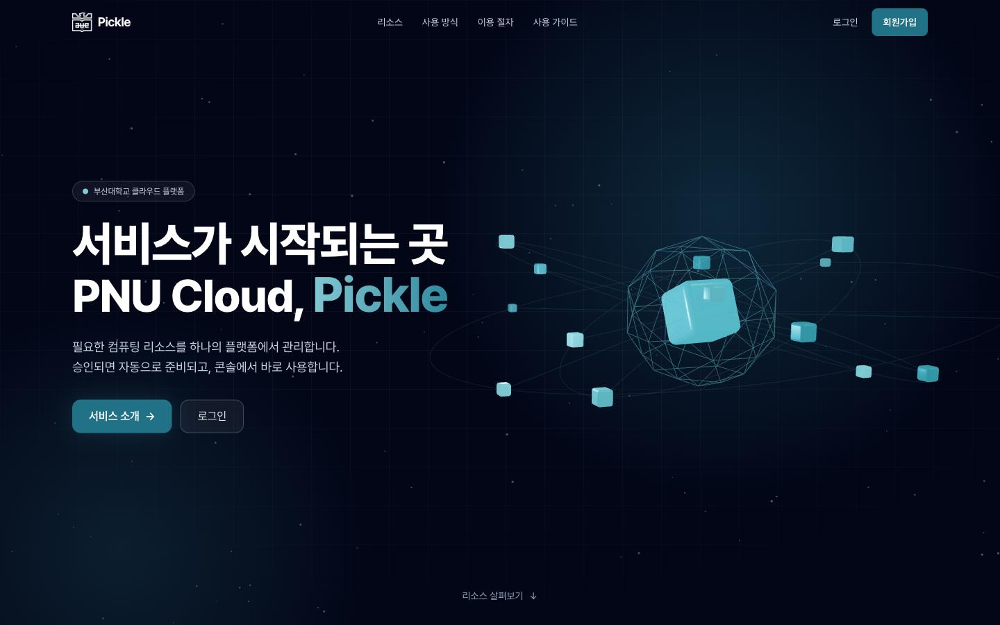
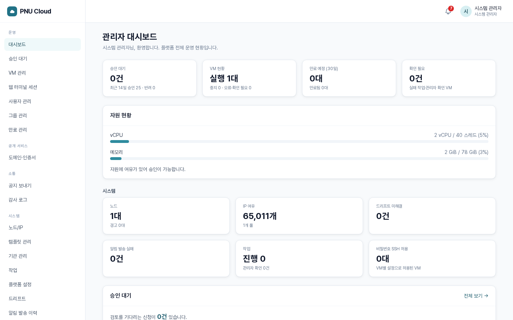
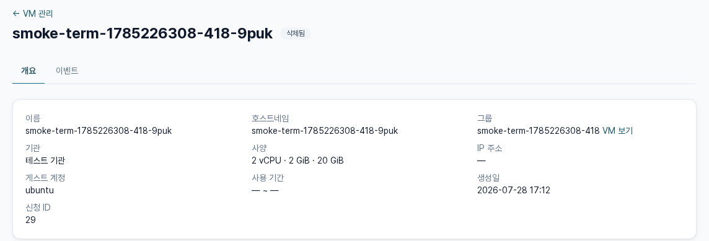
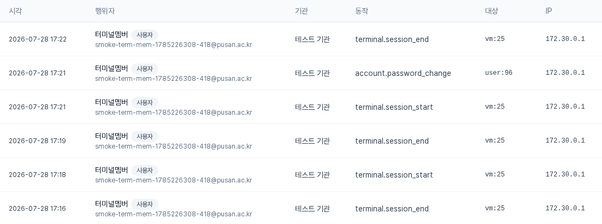
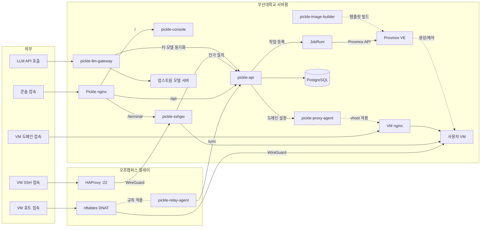

# pickle-console

부산대학교 클라우드 플랫폼(Pickle)의 웹 콘솔이에요.

랜딩 페이지부터 사용자 콘솔, 기관과 시스템 관리자 콘솔, 웹 터미널까지 사용자가
이 플랫폼을 만나는 모든 화면이 여기 있어요. nginx가 정적 빌드 산출물을 서빙하는
SPA이고, 데이터는 전부 백엔드 API에서 받아와요.

접속: https://pickle.pusan.ac.kr

<p align="center">
  
</p>

## 화면

리소스 신청, 승인 대기, 대시보드, VM별 SSH 개인키 발급, 웹 터미널, 도메인 공개로
이어지는 사용자 여정에 승인 큐와 감사 로그, 드리프트 리포트, 관리자 개입 같은 관리자
콘솔 화면이 더해져요. 아래는 그중 관리자 쪽 세 화면이에요.

<table>
  <tr>
    <td><br/><sub>관리자 대시보드. 승인 대기, VM 현황, 리소스 요약</sub></td>
    <td><br/><sub>VM 상세. 개요와 이벤트 탭, 정보 카드</sub></td>
  </tr>
  <tr>
    <td colspan="2" align="center"><br/><sub>관리자 감사 로그. 민감한 동작은 행위자와 IP가 함께 남아요</sub></td>
  </tr>
</table>

## 주요 기능

플랫폼은 VM 신청과 승인, 생성, SSH와 웹 터미널 접속, 도메인 공개, 만료와
삭제까지를 다뤄요. 이 레포지토리가 맡는 부분은 아래와 같아요.

- **신청과 공유**: 사용할 워크스페이스로 리소스를 신청하고 검토 결과를 확인해요.
  구성원과 소유자를 관리하고, 리소스마다 접근 권한을 따로 부여해요.
- **가상머신과 네트워크**: VM의 전원과 사용량, SSH와 웹 터미널 접속을 관리해요.
  웹 서비스와 TCP/UDP 포트를 공개하거나 VM 없이 도메인을 받아 DNS 레코드를 편집해요.
- **LLM API 키**: 승인된 키를 발급하고 사용량과 모델 권한, 본문 기록, 재발급과 폐기를
  관리해요. 키 평문은 발급할 때 한 번만 보여요.
- **관리자 콘솔**: 부여받은 업무와 기관, 워크스페이스 범위에서 신청과 자원, 사용자,
  사업 계정과 네트워크를 관리해요. 계정 상태와 2단계 인증 초기화는 시스템 관리자만 처리해요.
- **일괄 변경**: 대상과 변경 전후 값을 미리 확인하고, 저장된 적용 결과를 다시 조회해요.
  현재 열람할 수 없는 대상의 이름과 변경값은 가려요.
- **알림과 공지**: 처리 결과와 만료, 키 사용량 안내를 읽고 공지를 확인해요. 관리자는
  발송 대상을 미리 확인하고 알림과 공지를 작성해요.

워크스페이스 소유자와 승인 권한자는 최대 200명에게 VM이나 LLM API 키를 한 번에 신청할 수
있어요. DNS 레코드를 저장하면 표에서 지운 줄도 실제 DNS에서 삭제돼요.

신청 승인과 대상자별 리소스 등록, 실제 VM 생성이나 키 발급은 구분해서 표시해요.
가입 대기와 실패는 신청의 대상자 표에서 확인하고, 이미 만들어진 리소스는 해당 상세에서
관리해요. 워크스페이스 삭제와 초대 취소 전에는 종료 영향을 확인해요.

사용량은 조회한 기간과 함께 표시하고 미보고 값은 0과 구분해요. LLM 통계는 7일과 30일,
90일로 조회하며, 키의 누적 금액 사용과 기간별 요청 비용을 구분해요. 금액은 소수 여덟
자리까지 표시하되 0이 아닌 작은 값이 표시상 0이 되면 수신값의 숫자 표현을 사용해요.
반올림은 입력이나 비교에 적용하지 않아요.

알림 발송의 미리보기는 예상 대상이며 저장 결과는 실제 큐에 접수한 인원이에요.
SMTP 인계와 메일함 도착은 구분해요. 개인 사용량 알림 메일은 기본으로 켜져 있고
알림함에서 바꿀 수 있어요. 끄면 새 사용량 도달 메일만 중단해요.

## 동작 방식

로그인 후 `GET /api/v1/me/institution-authority`에서 받은 현재 기관 부여와 각 응답의
작업 허용 목록으로 메뉴와 작업을 결정해요. 표시 역할만으로 기관 업무를 허용하지 않아요.
기관 부여가 없거나 응답을 확인하지 못하면 기관 작업을 열지 않아요.
계정이나 부여, 업무 카탈로그가 바뀌면 이전 관리자 캐시와 편집 중인 입력을 폐기해요.
개인 콘솔의 소유자와 리소스 접근 권한, 시스템 계층의 작업 범위는 별도로 확인해요.
FULL의 개별 LLM 키 비용 읽기는 전역 예외를 유지하며 SELECTED는 실제 기관과 LLM 공간
범위를 적용해요. 재무 조회와 자격증명 관리, 쓰기는 각 업무의 기관 경계를 따라요.

일괄 변경의 저장된 미리보기는 24시간 동안 새 적용에 사용할 수 있어요. 이미 저장된 적용
결과는 이후에도 같은 ID로 조회해요. 응답을 받지 못하면 새 적용 ID를 만들지 않고 같은
ID의 결과를 확인해요. 마지막 저장은 현재 권한과 대상 상태를 다시 검사해요.

API는 항상 자기 오리진의 `/api`로 호출해요. 로컬에서는 Vite 프록시가, 배포된 환경에서는
각 환경의 nginx가 같은 경로를 해당 백엔드로 넘겨요. 빌드는 배포 대상 호스트를 고정하고,
다른 호스트에서 열리면 화면을 시작하지 않아요. 로컬 미리보기는 loopback 호스트에서 허용해요.

TypeScript 타입은 백엔드가 생성한 OpenAPI 스펙에서 만들어 레포지토리에 커밋해요. 명세가
바뀌면 diff에 드러나고, 스펙과 어긋난 코드는 타입 검사가 잡아내요.

테스트는 MSW로 API 전체를 목킹해 백엔드 없이 전 화면을 실행해요. 핸들러 픽스처가
프론트엔드가 기대하는 응답의 문서 역할도 해요.

웹 터미널 창은 `/terminal/<vm uuid>`, WebSocket 연결은 `/terminal/ws`를 사용해요.
WS 종단은 [pickle-sshgw](https://github.com/PNUops/pickle-sshgw)의 터미널 브리지가 맡아요.
터미널 창은 콘솔의 인증 스택을 마운트하지 않고, 콘솔 탭에서 `postMessage`로 일회용
접속 티켓을 받아요.

## 로그인 전환

로그인 후 계정과 현재 기관 부여를 확인하면 콘솔로 이동해요. 대기 중에는 스피너를
표시하고, 환영 문구는 콘솔 위에 짧게 표시한 뒤 첫 클릭이나 키 입력에서 닫혀요.
Google 로그인에서 2단계 인증을 거쳐도 검증된 콘솔 내부 복귀 주소를 유지해요.
로그아웃하면 이전 계정 정보와 복귀 주소를 초기화해요.

## 사용 가이드

`/docs`에서 서비스 소개와 리소스 사용, 계정과 문제 해결을 로그인 없이 읽을 수 있어요.
공개 `/docs/*`, 사용자 `/console/docs/*`, 워크스페이스별 `/console/:workspaceId/docs/*`,
관리자 `/admin/docs/*`는 같은 본문을 공유해요. 콘솔에서 열면 현재 워크스페이스와 기관을
유지하고, 모바일에서는 상단 메뉴로 문서 목차를 열어요.

본문은 `src/docs/articles/`에서 작성하고 `src/docs/catalog.ts`에 등록해요.
`GuideArticle`에 제목과 검색 키워드, 고정 slug, 절별 id와 본문을 작성해요.
문서 링크는 `GuideLink`, 사용자 작업 링크는 `GuideAction`을 사용해요.
경로 변환은 `src/lib/docs-paths.ts`가 맡아요.

이미지는 `src/assets/docs/`에서 import해 `GuideFigure`에 대체 텍스트와 짧은 캡션,
원본 너비와 높이를 지정해요. 동영상은 MP4와 대표 JPEG, 한국어 WebVTT 자막을
`GuideVideo`로 표시해요. 자동 재생하지 않고 본문의 텍스트 절차도 유지해요.
영상에 자막이 포함돼 있으면 선택형 자막 트랙은 기본으로 켜지 않아요.

합성 화면과 터미널 출력 재생은 캡션에서 실제 화면 녹화와 구분해요.
화면이나 동작이 바뀌면 관련 설명과 이미지를 함께 갱신해요. 개인정보와 자격증명이 없는
예시를 사용하고, 본문과 원본 링크, 좁은 화면의 표시를 검증해요. 캡처에 나온 한도와
사용량을 현재 정책의 근거로 삼지 않아요. 새 문서의 링크와 탐색은 화면 테스트로 확인해요.

## 유료 모델 규칙

LLM 키 승인, 관리자 한도 변경, OpenRouter 사업 계정의 승인 기본값은 하나의 입력란에서
허용과 차단 규칙을 함께 편집해요. 한 줄에 한 규칙을 적고 허용에는 `+`, 차단에는 `-`를
붙여요. 전체 내용을 한 번에 복사해 다른 입력란에 붙여 넣을 수 있어요.

```text
+openai/*
+anthropic/*
+google/*
-*/*-pro
```

공급자 자리의 `*`는 모든 공급자와 `~`로 시작하는 별칭을 포함해요. 모델 자리에는
정확한 이름, `gpt-5-*` 같은 계열, `*-pro` 같은 끝 이름 패턴을 사용해요.
차단이 허용보다 우선하며 줄 순서는 결과에 영향을 주지 않아요. `+` 규칙이 없으면
금액 한도 안에서 모든 유료 모델을 허용하고, `-` 규칙이 없으면 차단하지 않아요.
자체 서빙 모델은 이 규칙의 대상이 아니에요.

정확한 모델 이름은 `:batch` 같은 변형도 포함해요. 특정 공급자를 허용할 때는 `~` 별칭을
따로 적으며, 특정 공급자의 차단은 별칭에도 적용돼요. 규칙이 하나라도 있으면 모델을
대신 선택하는 `openrouter/` 이름은 사용할 수 없어요. 계정 기본값 변경은 다음 승인에
미리 채울 값만 바꾸며 이미 발급된 키에는 적용되지 않아요.

모델 카탈로그를 읽을 수 있으면 같은 편집기에서 저장된 모델을 검색하고 가격 상세를 확인해
규칙에 추가해요. 패턴 후보 수는 기능 권한과 실제 호출 가능성을 보장하지 않아요.
키와 계정 편집에서는 조회한 정책과 작성 중인 규칙을 비교해요. 이 비교는 서버의 동시 변경
검사 결과가 아니며, 일괄 변경의 저장된 미리보기와 구분해요.

`/admin/llm/models`는 검색어를 URL에 보존하고 공급자 갱신 시도와 마지막 성공, 오류 분류를
보여 줘요. 다시 조회 버튼은 서버에 저장된 결과만 읽어요. `/admin/llm/status`의 모델
구성 연결은 현재 읽을 수 있는 등록 공급원과 연결된 공개 모델만 보여 주며, 전체 모델 목록이나
실제 요청 처리 경로를 뜻하지 않아요. 제공되지 않은 연결과 시스템 화면의 미설정 상태를
구분해요.

## GPU 개발 미리 보기

GPU 신청과 할당, VM 연결, 반납, 관리자 검토 화면은 개발 모드에서
`VITE_GPU_PREVIEW=1 npm run dev:mock`으로 확인해요. `/console/gpus`는 사용자
목록이며 `/admin/gpus`는 관리자 인벤토리와 대기열, 검토 화면이에요. 실습할 데이터는
`src/test/msw/handlers/gpu.ts`의 픽스처로 지정해요. 개발 미리 보기는 할당과 대기, 연결 오류
예시를 불러오며 테스트 초기 인벤토리는 비어 있어요. 미리 보기에서 처리하지 못한 API
호출은 오류로 막아 실제 백엔드에 전달하지 않아요.

GPU 임대 기간은 신청자와 승인자가 시간 또는 일 단위로 직접 입력해요. 미연결과 저사용
검토 기준은 관리자 플랫폼 설정의 현재값을 사용하며 임대 기간과 별개예요. VM 연결은
대상과 전원 변경을 확인한 뒤 실행하고, 연결 해제 후에도 임대는 유지돼요.

기본 개발 모드와 production 빌드에서는 GPU 경로와 신청 선택을 열지 않아요.
사이드바의 GPU는 준비 중으로 유지하며 실제 서비스 개방은 별도로 진행해요.

## 공개 출발지 정책 기능 플래그

도메인과 포트포워딩의 출발지 정책 화면은 `VITE_PUBLIC_SOURCE_POLICY_ENABLED=1`인
빌드에서만 노출해요. 변수를 지정하지 않거나 다른 값을 넣으면 화면을 표시하지 않아요.
이 플래그는 화면 노출만 제어하며 API 권한 검사를 대신하지 않아요. 정책을 바꿔도 이미
연결된 세션을 강제로 종료하지 않고 새 연결부터 적용해요.
서비스가 연결된 도메인은 IPv4와 IPv6 주소와 CIDR을 받고, 포트포워딩은 relay 집행 범위에
맞춰 IPv4만 받아요. 플랫폼이 트래픽을 중계하지 않는 DNS 전용 도메인에는 이 화면을
표시하지 않아요. 상태는 비활성과 반영 대기, 설정 확인, 설정 실패로 구분하며 내부 적용
세대 숫자는 사용자 흐름에 노출하지 않아요. 교내 preset은 현재 CIDR을 입력 목록에
추가하는 snapshot이며 저장 뒤 자동으로 바뀌지 않아요.

## VM 통신 정책 기능 플래그

VM별 수신과 송신 규칙 화면은 `VITE_VM_NETWORK_POLICY_ENABLED=1`인 빌드에서만 노출하고,
기본으로 꺼져 있어요. 사용자 VM 상세의 네트워크 탭에서는 VIEWER 이상이 저장된 정책을
읽고 EDITOR 이상이 변경해요. 관리자 VM 상세는 대상 행에서 허용된 업무를 확인해요.
조회 업무나 변경 업무가 있으면 정책을 볼 수 있고, 변경 업무가 있어야 수정할 수 있어요.
기관 담당자는 실제 부여된 업무와 대상 워크스페이스 범위를 함께 검사해요.
시스템 계층의 변경은 기존 SYS_MANAGER와 SYS_ADMIN 범위를 따라요. 이 UI 플래그와
권한 판정은 화면 제어이고 최종 권한은 API가 검사해요.

사용자 규칙은 순서가 유지되는 최대 128개의 IPv4 CIDR 규칙이에요. 방향은 수신 또는 송신,
처리는 허용 또는 차단, 프로토콜은 전체 또는 TCP, UDP, ICMP이며 TCP/UDP만 단일 포트나 범위를
가질 수 있어요. 플랫폼 SSH, 웹 터미널과 공개 경로에 필요한 system rule은 목적과
설명만 읽을 수 있고 편집할 수 없어요. 저장은 revision CAS를 사용하므로 충돌 시 작성
중인 규칙을 보존하고 명시적으로 최신 정책을 불러와야 해요.

상태의 `설정 확인됨`은 서버가 방화벽 설정 반영을 다시 확인한 상태이며 실제 연결 성공을 뜻하지
않아요. `실패(차단 설정 확인)`은 변경 적용은 실패했지만 fail-closed 차단 설정의 반영을
확인한 상태예요. 준비되지 않았거나 API가 unavailable인 VM은 편집기를 표시하지 않아요.

## 스택

React 19, TypeScript, Vite 8, Tailwind 4, TanStack Query 5, react-router 8,
openapi-fetch. 웹 터미널은 xterm.js, 랜딩의 3D 히어로는 react-three-fiber, 사용량과 용량
추이 차트는 uPlot을 사용해요. 이 세 가지는 해당 화면을 열 때만 내려받아요.
2단계 인증 등록 화면의 QR 코드는 qrcode.react가 SVG로 그려요.
테스트는 vitest와 MSW 조합이고, 린트는 oxlint로 경고까지 실패로 취급해요.

Node.js 24(LTS)가 필요해요. `package.json`의 `engines`에 적혀 있어요.

## 시작하기

```bash
npm install
npm run dev              # /api·/terminal/ws 를 로컬 pickle-api :8080 으로 프록시
npm run dev:mock         # api 없이 목 데이터로 실행
scripts/verify.sh        # lint → typecheck → test → build → 취약점 감사
```

`dev:mock`은 데이터베이스나 API 없이 테스트의 목 핸들러로 화면을 실행해요.
로그인과 신청, 승인, 접속 이름 중복 같은 실패를 확인할 수 있어요.
새로고침하면 처음 상태로 돌아가고, 목 코드는 운영 번들에 들어가지 않아요.

`VITE_MOCK_USER=admin npm run dev:mock`에서 `/admin/llm/status?tab=metrics&view=capacity`를
열면 장비 이력의 합성 표본과 빈 구간을 확인할 수 있어요. 같은 주소의
`observationFixture`에 `not-configured`, `not-reported`, `stale`, `source-failed`,
`unknown`을 지정하면 해당 목 응답을 선택해요. 보존 경계 전후의 조회 기간을 선택하면
보존 경계 밖의 과거와 부분 보존을 구분해요. `VITE_MOCK_USER=org-viewer`에서는 전역 장비
정보를 제공하지 않아요. 목 API에서 처리하지 않는 `/api/` 요청은 오류로 끝나고 실제
백엔드로 넘기지 않아요.

`npm run dev:mock`에서 `/console/notifications?usageAlertFixture=demo`를 열면
TOKEN 80%와 CREDIT 100%의 합성 안내를 확인해요. `access-revoked`는 키 접근 회수 후 새 사용량 안내만
숨기는 상태, `error`는 알림 조회 실패 상태예요. 개인 메일 설정은 같은 문서 안에서
계정별로 저장되며 새로고침하면 초기화돼요. `usageMailFixture=save-error`는 설정 저장
실패를 재현해요. 다른 합성 계정은 `VITE_MOCK_USER=user-b npm run dev:mock`으로
선택해요.

| 명령 | 내용 |
|---|---|
| `npm run lint` / `npm run typecheck` | oxlint / `tsc -b` |
| `npm run test` / `npm run test:watch` | vitest 1회 실행 / 워치 |
| `npm run build` / `npm run preview` | 프로덕션 빌드 / 미리보기 |
| `npm run gen:api` | API 타입 재생성 |

`verify.sh` 안의 `npm audit --omit=dev --audit-level=high`는 차단 게이트예요. 런타임
의존성에 high 이상 취약점이 있으면 검증이 실패해요.

### 로그인 계정

로컬 백엔드를 dev 프로파일로 띄우면 빈 데이터베이스에 개발용 계정 둘이 만들어져요.
시스템 관리자는 `admin@pickle.local`, 기관 관리자는 `orgadmin@pickle.local`이에요.
비밀번호는 백엔드를 기동할 때 환경 변수로 준 값이라 여기에는 적혀 있지 않아요. 신청과
승인에 필요한 기관과 OS, 사양 프리셋도 같이 들어오므로 화면을 처음부터 따라갈 수
있어요. 이 계정들은 dev 전용이고, 운영 환경에서는 운영자 부트스트랩 절차가 관리자
계정을 만들어요.

## 빌드 대상

배포용 빌드는 대상 브랜치와 함께 `VITE_DEPLOY_TARGET`을 명시해요.
`production`은 `pickle.pusan.ac.kr`, `development`는 `pickle.pnuops.com`에서만
화면을 시작해요. 빌드 결과의 로컬 미리보기는 `localhost`, `127.0.0.1`,
`[::1]`에서도 시작해요. 로컬 Vite 개발 서버는 기본적으로 `development`를 사용하며
호스트 검사는 적용하지 않아요.

| 변수 | 값 | 역할 |
|---|---|---|
| `VITE_DEPLOY_TARGET` | `production` 또는 `development` | 배포 호스트와 사용 안내의 외부 접속 주소를 선택해요. 일반 로컬 빌드의 기본값은 `production`이에요. |
| `VITE_DEV_SSH_HOST` | 개발 전용 `*.pnuops.com` 호스트, 선택 | 없으면 개발 화면의 SSH 예시를 비활성화해요. |
| `VITE_DEV_LLM_BASE_URL` | 개발 전용 `https://*.pnuops.com/v1`, 선택 | 없으면 개발 화면의 LLM 연결 정보와 예시를 비활성화해요. |

```bash
VITE_DEPLOY_TARGET=development npm run build
VITE_DEPLOY_TARGET=production npm run build
```

개발 빌드에 외부 접속 주소를 설정하면 해당 개발 서비스가 실제로 준비된 뒤에만 사용해요.
운영 서비스 주소가 개발 빌드의 최종 출력 파일에 들어가면 빌드가 실패해요.
이 검사는 `public/`에서 복사한 파일과 바이너리 asset도 포함해요. 개발 API와 DNS, 메일 연동의
대상은 콘솔 번들이 아니라 같은 오리진의 개발 API 설정에서 결정해요.

## API 타입 생성

```bash
npm run gen:api   # ../api/contract/openapi.yaml → src/api/schema.d.ts

# 별도 checkout이나 worktree의 명세를 사용할 때
OPENAPI_SCHEMA=/absolute/path/to/openapi.yaml npm run gen:api
```

[pickle-api](https://github.com/PNUops/pickle-api) 레포지토리가 형제 디렉터리(`../api`)로
체크아웃돼 있다고 가정해요. `OPENAPI_SCHEMA`를 지정하면 그 파일을 입력으로 사용하며
출력은 `src/api/schema.d.ts`에 저장해요. 산출물은 커밋 대상이에요.

## 레포지토리 구조

```
src/api/         생성된 타입(schema.d.ts)과 쿼리 래퍼
src/auth/        권한과 역할 판정
src/pages/       화면 (랜딩·사용자·관리자)
src/terminal/    웹 터미널 창 — 화면·소켓 훅·콘솔 탭과의 티켓 중계
src/components/  src/layouts/   공용 UI
src/lib/         상태·라벨 매핑, 포맷, 검증 유틸
src/test/        vitest 설정과 MSW 목
public/          빌드가 그대로 내보내는 정적 파일
assets/          README 스크린샷
```

`public/pnu-logo.png`는 favicon과 발송된 메일이 절대 URL로 참조하므로 경로를 유지해요.
엠블럼을 교체할 때는 `src/assets/pnu-logo.png`도 함께 바꿔요.

최종 갱신: 2026-11-03

## 전체 아키텍처

<!-- arch:begin -->


| 레포지토리 | 역할 |
|---|---|
| [pickle-api](https://github.com/PNUops/pickle-api) | REST API와 프로비저닝 워커 (Spring Boot 4, Java 25, PostgreSQL 18, JobRunr) |
| [pickle-console](https://github.com/PNUops/pickle-console) | 사용자·관리자 웹 콘솔 (React 19, TypeScript) |
| [pickle-sshgw](https://github.com/PNUops/pickle-sshgw) | SSH 게이트웨이와 웹 터미널 브리지 (sshpiperd, Go) |
| [pickle-proxy-agent](https://github.com/PNUops/pickle-proxy-agent) | nginx 리버스 프록시 제어 에이전트 (Go) |
| [pickle-relay-agent](https://github.com/PNUops/pickle-relay-agent) | 오프캠퍼스 릴레이의 nftables DNAT 에이전트 (Go) |
| [pickle-llm-gateway](https://github.com/PNUops/pickle-llm-gateway) | 교내 LLM API 게이트웨이 (Go) |
| [pickle-image-builder](https://github.com/PNUops/pickle-image-builder) | 사용자 VM OS 이미지 빌드 레시피 (shell, virt-customize) |
| [pickle-infra](https://github.com/PNUops/pickle-infra) (비공개) | 인프라 프로비저닝 스크립트와 운영 런북 (shell) |
| [pickle-infra-example](https://github.com/PNUops/pickle-infra-example) | 프로비저닝·배포 스크립트와 런북 샘플 |
| [pickle-secrets](https://github.com/PNUops/pickle-secrets) (비공개) | 호스트 시크릿 볼트 (git-crypt) |
| [pickle-secrets-example](https://github.com/PNUops/pickle-secrets-example) | 볼트 레이아웃과 git-crypt 운용 절차 |
<!-- arch:end -->
